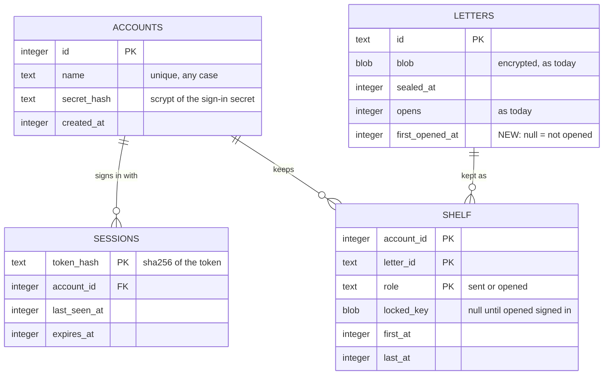
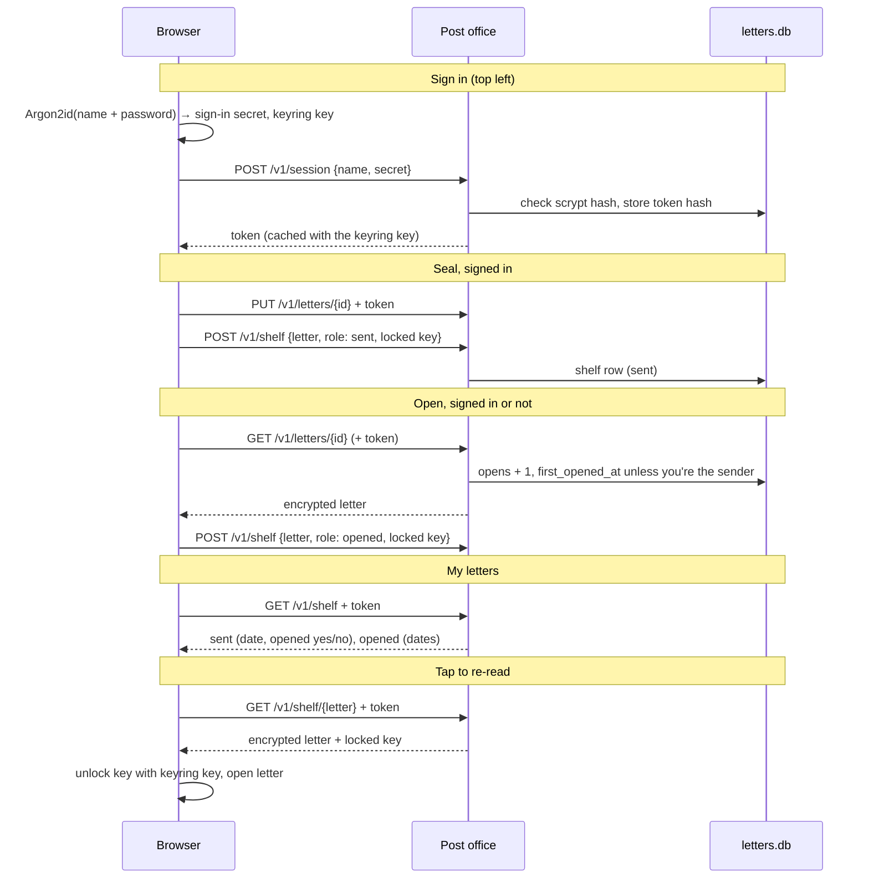

# Accounts — design notes

A record of what has been decided. Not built yet. No account name or password ever goes in this file or anywhere in the repo (it is public).

## Decided

| # | Decision | Decided |
|---|----------|---------|
| 1 | Accounts are optional. A **sign in** button sits at the top left; reading and writing letters work without one. | 2026-11-14 |
| 2 | **Invite-only.** Accounts are made on the Mac with a small script; the site has no sign-up page. | 2026-11-14 |
| 3 | A letter sealed while signed in goes on your **sent** list: when you sealed it, and whether it's been opened (yes/no). | 2026-11-14 |
| 4 | A letter opened while signed in goes on your **opened** list, and can be **re-read with one tap**, without its name + password. | 2026-11-14 |
| 5 | Opening your own letter while signed in doesn't mark it opened. | 2026-11-14 |
| 6 | **The post office can't read letters, even with accounts.** Keys on your shelf are locked with a key made from your account password, which never leaves your browser. | 2026-11-14 |
| 7 | New letters and account passwords use **Argon2id** (much slower to guess than PBKDF2). Old letters keep opening the old way. | 2026-11-14 |
| 8 | Nothing that matters lives in the browser. A device may remember your sign-in, but only as a cache: lose it and you sign in again, nothing is lost. | 2026-11-14 |
| 9 | No password-strength hints for letter passwords. | 2026-11-14 |
| 10 | The pages get a Content-Security-Policy, so only their own scripts run. | 2026-11-14 |
| 11 | The 10 letters sent before accounts are put on shelves **one by one**, by hand, with their first-open times taken from catseye. | 2026-11-14 |

## Keys

Everything secret is made in the browser from what you type, the same way letters already work:

| You type | Argon2id gives 64 bytes | Goes to the server | Stays in the browser |
|---|---|---|---|
| letter name + password | id · key | id (to find the letter) | key (opens the letter) |
| account name + password | sign-in secret · keyring key | sign-in secret (stored as an scrypt hash) | keyring key (locks and unlocks your shelf keys) |

So the server holds letters it can't read, and shelf keys it can't unlock. A copy of the database is useless without guessing passwords, and each guess costs ~0.5 s of Argon2id.

If you forget your account password: it's reset on the Mac and your lists stay, but each letter needs its name + password once more to become tap-to-read again.

Argon2id settings: 64 MiB, 3 passes, 1 lane. Browser: [hash-wasm](https://www.npmjs.com/package/hash-wasm) 4.12.0 from jsdelivr. Mac: Node's built-in `crypto.argon2`.

## Database

`~/.loveletter/letters.db`. `letters` gains one column; three tables are new.

- "Opened" on your sent list is `first_opened_at IS NOT NULL`. It's set by the first open from anyone who isn't on the shelf as its sender (signed-out opens count).
- `locked_key` is the letter's key, encrypted (AES-GCM) with the account's keyring key.

## Flows

## Letters from before accounts

10 letters, sealed 2026-11-11 to 11-14, all opened. For each: who sent it and who opened it. Decided one by one on 2026-11-14 and kept only on the Mac, in `~/.loveletter/backfill.json` (owner-only, never committed: it holds real account names). `node server/accounts.js backfill ~/.loveletter/backfill.json` applies it once the accounts exist, then deletes the file.

## Progress

1. **Post office** (accounts, sessions, shelves, backfill, the `server/accounts.js` command): built 2026-11-14. The database was backed up first, to `~/.loveletter/backups/letters-before-accounts.db`.
2. Argon2id for new letters.
3. **Pages** (sign-in button top left on both pages, "my letters", tap to re-read through the postman): built 2026-11-14, ahead of step 2. Each shelf entry locks the letter's key plus a small peek (who it's from, its first line, how many photos), so the lists show more than dates; the server still can't read any of it.
4. Content-Security-Policy. Each goes on both shelves with no key yet (`locked_key` null), so it shows in both lists right away and becomes tap-to-read once that person opens it signed in. `first_opened_at` comes from catseye's `letter_opened` events (`first: true`), matched by size and time.
